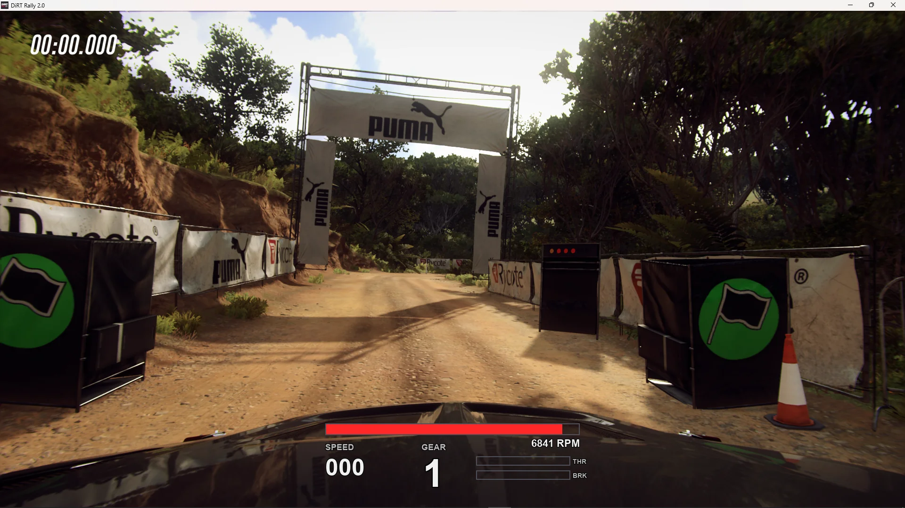

# CustomRallyDash: Telemetry Dashboard for DiRT Rally 2.0

[Türkçe](README_TR.md) | **English**

[](https://github.com/alpivenator/CustomRallyDash/releases)
[](https://www.python.org/)
[](LICENSE)

CustomRallyDash is a real-time telemetry dashboard and overlay for DiRT Rally 2.0. It reads 60 Hz UDP (`Extradata=3`) packets from the game and renders a compact digital HUD or a circular analog tachometer, with optional Windows click-through overlay support and Raspberry Pi GPIO shift lights.



## Features

- Horizontal digital bar HUD and circular analog tachometer with dynamic redline detection
- Borderless, click-through Windows overlay supporting `chroma` (transparent background) and `alpha` (semi-transparent) modes
- Terminal UI tools built with `rich` and `questionary`: bilingual (EN/TR) setup wizard and theme selector, plus a UDP telemetry checker
- Five built-in color presets: `Modern Dark (Default)`, `Subaru Classic WRC`, `GT3 Competition`, `Night Stage Neon (Cyberpunk)`, and `Retro 90s Amber`
- Standalone 60 Hz mock telemetry broadcaster modeling WRC acceleration, sequential shifts, and braking for offline testing
- Physical GPIO shift-light support on Raspberry Pi via `gpiozero`
- Plain Python configuration in `config.py` (system and runtime) and `settings.py` (layout and colors)

## Requirements

- Python `3.11.x`, `3.12.x`, or `3.13.x` (Python 3.14+ is not supported yet)
- Core packages (`requirements.txt`):
  - `pygame==2.6.1` (dashboard rendering)
  - `rich>=13.9,<16` (terminal UI panels, tables, and status output)
  - `questionary>=2.0,<3` (arrow-key CLI prompts)
- Optional (`requirements-pi.txt`): `gpiozero==2.0.1` (physical GPIO shift lights on Raspberry Pi)

## Quick start

### 1. Get the code

Clone the repository or download a release archive:

```sh
git clone https://github.com/alpivenator/CustomRallyDash.git
cd CustomRallyDash
```

If you download the `.zip` archive from [GitHub Releases](https://github.com/alpivenator/CustomRallyDash/releases/latest) on Windows, right-click the file, open **Properties**, check **Unblock**, and click **Apply** before extracting.

### 2. Setup and launch

#### Windows

1. Double-click `install.bat` to create `.venv`, install dependencies, and run the DiRT Rally 2.0 setup wizard.
2. Start DiRT Rally 2.0 in **Windowed** or **Borderless Windowed** mode so the overlay stays on top, then double-click `run_dash.bat`.

Available batch scripts in the repository root:

| Script | Purpose | Description |
| :--- | :--- | :--- |
| `install.bat` | First-time setup | Creates `.venv`, installs dependencies, and runs the setup wizard. |
| `run_dash.bat` | Launch dashboard | Starts the telemetry dashboard. |
| `select_theme.bat` | Theme switcher | Interactive CLI to apply color presets to `settings.py`. |
| `run_mock.bat` | Mock broadcaster | Sends simulated 60 Hz UDP telemetry (run alongside `run_dash.bat`). |
| `check_telemetry.bat` | Diagnostics | Listens for incoming 264-byte UDP packets and checks connectivity. |

#### Linux and CLI

Run the installer script to create `.venv`, install dependencies, and launch the setup wizard:

```sh
./install.sh          # standard setup
./install.sh --pi     # also install Raspberry Pi GPIO dependencies
./install.sh --dev    # also install dev tools (pytest, ruff, black, pip-audit)
```

If you prefer manual setup, or want to run the dashboard and tools directly:

```sh
python3 -m venv .venv
source .venv/bin/activate
pip install --upgrade pip
pip install -r requirements.txt
python tools/setup_wizard.py

# Launch dashboard (add --mock to preview with synthetic telemetry)
python main.py

# Switch color theme
python tools/theme_selector.py
```

## Game UDP and display configuration

DiRT Rally 2.0 sends UDP telemetry when configured in `hardware_settings_config.xml`:

```text
Documents\My Games\DiRT Rally 2.0\hardwaresettings\hardware_settings_config.xml
```

Make sure the `<motion_platform>` section includes this entry:

```xml
<udp enabled="true" extradata="3" ip="127.0.0.1" port="20777" delay="1" />
```

When running the dashboard on another PC or a Raspberry Pi, set `ip` to that device's local LAN IPv4 address. On Windows, keep the game in **Windowed** or **Borderless Windowed** mode if you use the click-through overlay.

## Architecture and configuration

- `config.py`: System settings including network interface (`LISTEN_IP`, `LISTEN_PORT`), dashboard style (`DASH_STYLE`), overlay toggle (`ENABLE_OVERLAY`), and LED toggle (`ENABLE_LEDS`).
- `settings.py`: Visual settings including window size, scaling (`TARGET_SCALE`), overlay placement and transparency (`OVERLAY_MODE`, `OVERLAY_POSITION`, `OVERLAY_CHROMA_KEY`), colors, and font sizes.
- `core/`: UDP packet parser (`udp_listener.py`), Win32 overlay helpers (`overlay_win.py`), and GPIO LED driver (`led_controller.py`).
- `dashboards/`: Pygame renderers (`digital_dash.py`, `analog_dash.py`) and theme presets (`themes.py`).
- `tools/`: Shared TUI helpers (`cli_ui.py`), setup wizard (`setup_wizard.py`), packet checker (`telemetry_check.py`), mock telemetry generator (`mock_telemetry.py`), and theme CLI (`theme_selector.py`).

See [docs/CONFIGURATION.md](docs/CONFIGURATION.md) for all configuration options and network notes.

## Documentation

- [Architecture and data flow](docs/ARCHITECTURE.md) ([Türkçe](docs/ARCHITECTURE_TR.md))
- [Configuration reference](docs/CONFIGURATION.md) ([Türkçe](docs/CONFIGURATION_TR.md))
- [Changelog](docs/CHANGELOG.md) ([Türkçe](docs/CHANGELOG_TR.md))
- [Roadmap](docs/ROADMAP.md) ([Türkçe](docs/ROADMAP_TR.md))

## License

This project is licensed under the MIT license. See [LICENSE](LICENSE) for details.
