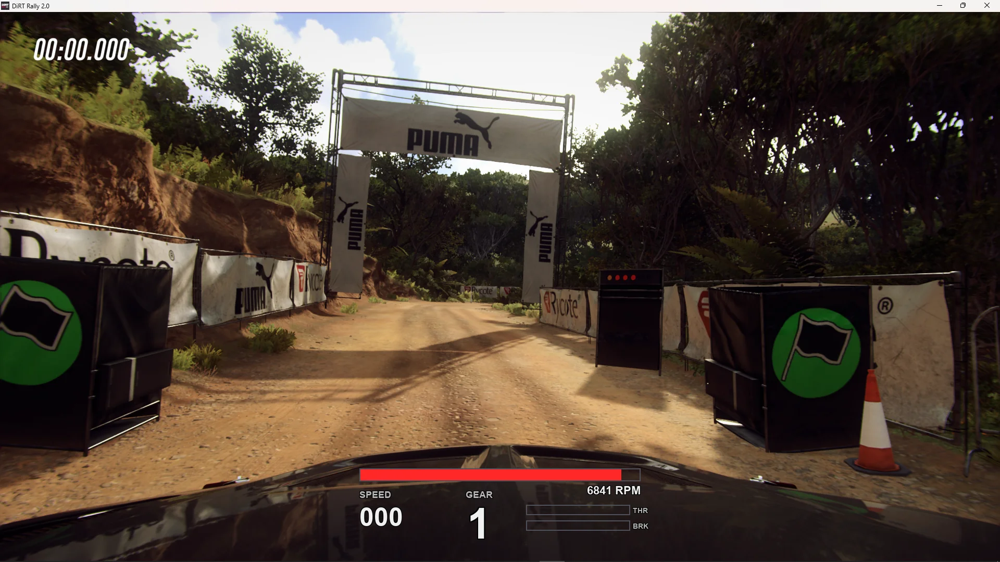

# CustomRallyDash: DiRT Rally 2.0 Telemetri Göstergesi

[English](README.md) | **Türkçe**

[](https://github.com/alpivenator/CustomRallyDash/releases)
[](https://www.python.org/)
[](LICENSE)

CustomRallyDash, DiRT Rally 2.0 için hazırlanmış bir telemetri göstergesi ve oyun içi HUD aracıdır. Oyundan 60 Hz'de gelen UDP (`Extradata=3`) paketlerini okuyup düşük gecikmeyle ekrana çizer. Yatay dijital bar, dairesel analog devir saati, Windows üzerinde tıklama geçiren şeffaf overlay ve Raspberry Pi GPIO vites ışıklarını destekler.



## Özellikler

- Yatay dijital HUD ve araca göre redline belirleyen dairesel analog devir saati
- Windows'ta oyun üzerinde kalan, `chroma` (arka planı tamamen şeffaf) ve `alpha` (yarı saydam) modlu çerçevesiz tıklama geçirgen overlay
- Beş hazır palet içeren etkileşimli tema seçici: `Modern Dark (Default)`, `Subaru Classic WRC`, `GT3 Competition`, `Night Stage Neon (Cyberpunk)` ve `Retro 90s Amber`
- Oyunu açmadan test ve görsel ayar yapabilmek için WRC hızlanma, sıralı vites geçişi ve frenleme üreten 60 Hz mock telemetri yayıncısı
- Raspberry Pi üzerinde `gpiozero` ile fiziksel GPIO vites ışığı desteği
- Ek dosya ayrıştırıcısı kullanmadan doğrudan `config.py` (sistem ve ağ) ile `settings.py` (arayüz ve renk) üzerinden yapılandırma

## Gereksinimler

- Python `3.11.x`, `3.12.x` veya `3.13.x` (Python 3.14+ henüz desteklenmiyor)
- `pygame==2.6.1`, Raspberry Pi üzerinde LED kullanılacaksa ek olarak `gpiozero==2.0.1`

## Hızlı başlangıç

### 1. Projeyi edinin

Depoyu klonlayın veya sürüm arşivini indirin:

```sh
git clone https://github.com/alpivenator/CustomRallyDash.git
cd CustomRallyDash
```

Windows'ta [GitHub Releases](https://github.com/alpivenator/CustomRallyDash/releases/latest) sayfasından `.zip` arşivi indirirseniz dosyayı açmadan önce sağ tıklayıp **Özellikler → Engellemeyi Kaldır → Uygula** adımlarını izleyin.

### 2. Kurulum ve çalıştırma

#### Windows

1. `.venv` sanal ortamını oluşturmak, bağımlılıkları kurmak ve DiRT Rally 2.0 kurulum sihirbazını açmak için `install.bat` dosyasına çift tıklayın.
2. DiRT Rally 2.0'ı **Pencereli** veya **Çerçevesiz Pencereli** moda alın, ardından `run_dash.bat` dosyasını çalıştırın.

Depo kökündeki hazır `.bat` betikleri:

| Betik | Amaç | Açıklama |
| :--- | :--- | :--- |
| `install.bat` | İlk kurulum | `.venv` ortamını kurar, bağımlılıkları yükler ve kurulum sihirbazını başlatır. |
| `run_dash.bat` | Göstergeyi başlatma | Telemetri göstergesini açar. |
| `select_theme.bat` | Tema seçimi | Hazır renk paletlerini `settings.py` dosyasına uygular. |
| `run_mock.bat` | Mock yayını | 60 Hz test verisi gönderir (`run_dash.bat` ile birlikte kullanılır). |
| `check_telemetry.bat` | Bağlantı testi | Oyundan 264 baytlık UDP paketlerinin gelip gelmediğini kontrol eder. |

#### Linux ve komut satırı

`.venv` ortamını kurmak, bağımlılıkları yüklemek ve kurulum sihirbazını açmak için `install.sh` betiğini çalıştırın:

```sh
./install.sh          # standart kurulum
./install.sh --pi     # Raspberry Pi GPIO bağımlılığını da kurar
./install.sh --dev    # geliştirici araçlarını da kurar (pytest, ruff, black, pip-audit)
```

Kurulumu elle yapmak isterseniz:

```sh
python3 -m venv .venv
source .venv/bin/activate
pip install --upgrade pip
pip install -r requirements.txt
python tools/setup_wizard.py

# Göstergeyi başlat (mock telemetri ile önizleme için --mock ekleyin)
python main.py

# Renk temasını değiştir
python tools/theme_selector.py
```

## Oyun UDP ve ekran ayarları

DiRT Rally 2.0'ın UDP telemetrisi göndermesi için `hardware_settings_config.xml` dosyasını düzenleyin:

```text
Belgeler\My Games\DiRT Rally 2.0\hardwaresettings\hardware_settings_config.xml
```

`<motion_platform>` bölümünde şu satırın bulunduğunu doğrulayın:

```xml
<udp enabled="true" extradata="3" ip="127.0.0.1" port="20777" delay="1" />
```

Gösterge ayrı bir bilgisayarda veya Raspberry Pi'de çalışıyorsa `ip` alanına o cihazın yerel ağ IPv4 adresini yazın. Windows'ta overlay'in oyunun üstünde kalması için görüntü ayarını **Pencereli (Windowed)** veya **Çerçevesiz Pencereli (Borderless Windowed)** olarak seçin.

## Mimari ve yapılandırma

- `config.py`: Ağ arayüzü (`LISTEN_IP`, `LISTEN_PORT`), gösterge stili (`DASH_STYLE`), overlay anahtarı (`ENABLE_OVERLAY`) ve LED anahtarı (`ENABLE_LEDS`).
- `settings.py`: Pencere boyutları, ölçekleme (`TARGET_SCALE`), overlay konumu ve saydamlık ayarları (`OVERLAY_MODE`, `OVERLAY_POSITION`, `OVERLAY_CHROMA_KEY`), renk paleti ve yazı boyutları.
- `core/`: UDP paket çözücüsü (`udp_listener.py`), Windows Win32 overlay yardımcıları (`overlay_win.py`) ve GPIO LED sürücüsü (`led_controller.py`).
- `dashboards/`: Pygame çizim modülleri (`digital_dash.py`, `analog_dash.py`) ve hazır temalar (`themes.py`).
- `tools/`: Kurulum sihirbazı (`setup_wizard.py`), paket kontrol aracı (`telemetry_check.py`), mock telemetri üreteci (`mock_telemetry.py`) ve tema seçici (`theme_selector.py`).

Tüm ayarlar ve ağ notları için [docs/CONFIGURATION_TR.md](docs/CONFIGURATION_TR.md) dosyasına bakın.

## Dokümantasyon

- [Mimari ve veri akışı](docs/ARCHITECTURE_TR.md) ([English](docs/ARCHITECTURE.md))
- [Yapılandırma kılavuzu](docs/CONFIGURATION_TR.md) ([English](docs/CONFIGURATION.md))
- [Sürüm geçmişi](docs/CHANGELOG_TR.md) ([English](docs/CHANGELOG.md))
- [Yol haritası](docs/ROADMAP_TR.md) ([English](docs/ROADMAP.md))

## Lisans

Bu proje MIT lisansı altındadır. Ayrıntılar için [LICENSE](LICENSE) dosyasına bakabilirsiniz.
